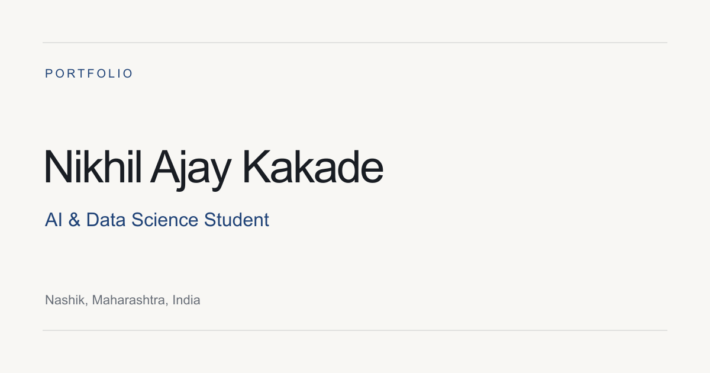

# ✨ Nikhil Kakade | Developer Portfolio

<p align="center">
  
</p>

<p align="center">
  <strong>AI & Data Science Student | Developer | Cybersecurity Enthusiast</strong>
</p>

<p align="center">
  A personal portfolio showcasing my skills, projects, education, and journey in technology.
</p>

<p align="center">
  
  
  
  
  
</p>

---

## 🚀 About the Project

This repository contains my personal developer portfolio, built to present my technical skills, academic background, projects, and résumé in one place.

### ✨ Highlights

- 🎨 Modern, responsive portfolio interface
- 📱 Mobile-friendly layout
- 🧑‍💻 Dedicated project and skills sections
- 📄 Résumé download
- 🌗 Theme toggle and mobile navigation in the standalone version
- ⚡ Next.js application for a modern web experience
- 🌐 Standalone HTML version that works without Node.js

## 🛠️ Technology Stack

| Technology | Purpose |
|---|---|
| Next.js | Main portfolio application |
| React | Reusable UI components |
| JavaScript | Interactive functionality |
| HTML5 & CSS3 | Structure and styling |
| Git & GitHub | Version control |

## 📂 Project Structure

```text
portfolio/
├── public/
│   ├── profile.jpeg
│   ├── resume.pdf
│   └── social-preview.png
├── standalone/
│   ├── index.html
│   ├── style.css
│   ├── script.js
│   ├── README.md
│   └── assets/
│       ├── images/
│       └── documents/
├── src/
│   ├── app/
│   ├── components/
│   ├── data/
│   ├── hooks/
│   ├── lib/
│   └── styles/
├── qa/
├── package.json
├── DEPLOYMENT.md
└── README.md
```

## ⚙️ Getting Started

### Option 1: Open the standalone portfolio

No Node.js installation or development server is required.

1. Open `D:\portfolio\standalone` in File Explorer.
2. Double-click `index.html`.
3. View the portfolio in Chrome or Edge.

Keep `style.css`, `script.js`, and the `assets` folder alongside `index.html`.

### Option 2: Run the Next.js application

**Prerequisites:** Node.js and npm.

1. Open `D:\portfolio` in VS Code.
2. Open the integrated terminal.
3. Install dependencies if needed:

   ```powershell
   npm install
   ```

4. Start the development server:

   ```powershell
   npm run dev
   ```

5. Open `http://localhost:3000` in your browser.

### Available Commands

```powershell
npm run dev
npm run typecheck
npm run build
npm start
```

Use `npm start` after creating a production build with `npm run build`.

## 👨‍💻 Author

**Nikhil Kakade**

AI & Data Science Student | Developer | Cybersecurity Enthusiast

<p align="center">
  <i>Learning, building, and creating technology that solves real problems.</i>
</p>
